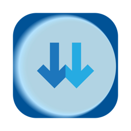
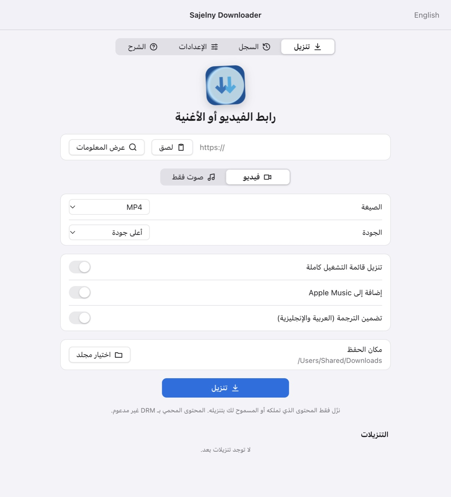

<h1 align="center">Sajelny Downloader</h1>

  <a href="https://github.com/ahmedabdeien/sajelny-downloader/releases/latest/download/Sajelny-Downloader-arm64.dmg"><b>تنزيل أحدث إصدار / Download the latest version</b></a>
  ·
  <a href="https://sajelny.com/downloader">sajelny.com/downloader</a>

برنامج لأجهزة ماك لتنزيل الفيديو والصوت من المواقع المدعومة، بالصيغة والجودة التي تختارها.
لا يحتاج إلى تثبيت أي أداة أخرى.

## المميزات

- فيديو بصيغ MP4 وMKV وWEBM، وصوت بصيغ M4A وMP3 وFLAC وWAV وOPUS.
- غلاف للصيغ التي تدعمه، وإضافة إلى Apple Music.
- عدة روابط معا، واختيار فيديوهات من قائمة التشغيل، والسحب والإفلات.
- ترتيب الملفات في مجلدات، وسجل للتنزيلات.
- وضع نهاري وليلي، وواجهة وقائمة بالعربية والإنجليزية، وأيقونة في شريط القوائم.
- محرك بـ Swift لروابط الملفات المباشرة، مع استكمال التنزيل المنقطع عندما يدعمه الخادم.
- فحص تحديث البرنامج من داخله، والتحقق من بصمة الملف قبل فتحه.

## المتطلبات

ماك بمعالج Apple Silicon. إصدار Intel غير متاح حاليا.

## التثبيت

1. نزل ملف DMG وافتحه.
2. اسحب البرنامج إلى Applications.
3. البرنامج غير موقع من Apple. إن منعه النظام عند أول فتح، اسمح له من
   System Settings ثم Privacy & Security.

## إضافة المتصفح

الإصدار الأول من إضافة Chrome قيد مراجعة المتجر ولم ينشر بعد.

## الخصوصية والاستخدام

الإعدادات وسجل التنزيلات تبقى على جهازك.
[سياسة الخصوصية](https://sajelny.com/downloader/privacy) · [الدعم](https://sajelny.com/contact)

نزل فقط المحتوى الذي تملكه أو المسموح لك بتنزيله، وراع شروط كل موقع. المحتوى المحمي بـ DRM
غير مدعوم.

## English

A macOS app that downloads video and audio from supported sites, in the format and quality you
choose. Nothing else needs to be installed. Requires a Mac with Apple Silicon.

Download the DMG, drag the app onto Applications, and open it. The app is not signed by Apple:
if macOS blocks the first launch, allow it in System Settings, Privacy & Security.

Download only content you own or are allowed to download. DRM-protected content is not supported.

## Third-party software

The app includes yt-dlp, FFmpeg (GPL) and Deno. Versions, licences and source links are listed in
each release and in its `THIRD_PARTY.md`. This repository holds releases only.
